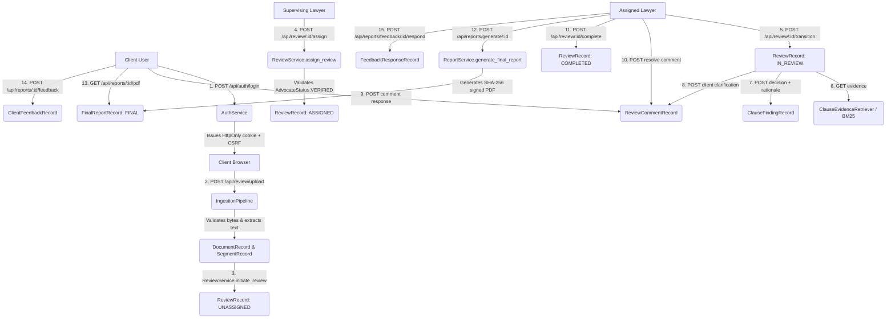

# TASK 037 — INTEGRATION ASSESSMENT AND ARCHITECTURE MAP

**Project:** CONTRACTRISK-XAI  
**Task:** 037 — End-to-End Contract Lifecycle Integration  
**Phase:** Phase 1 — Repository and Architecture Inspection  
**Date:** 2026-10-15  

---

## 1. Executive Summary

This integration assessment documents the architectural inspection of the CONTRACTRISK-XAI repository prior to implementing Task 037. The inspection evaluated the interfaces, service boundaries, database transactions, state machine transitions, and cross-cutting security protections across:
1. Document ingestion and persistence (`src/ingestion/`, `src/persistence/`)
2. Authentication, RBAC, and secure session management (`src/auth/`)
3. Statutory legal corpus and retrieval (`src/legal_sources/`, `data/legal_sources/`)
4. Collaborative lawyer review workbench (`src/review/`)
5. Final reporting and client feedback (`src/reporting/`)
6. Modernized LegalTech UI and dashboard (`src/dashboard/`)
7. Cryptographic audit provenance logging (`src/audit/`)

---

## 2. Components Inspected

| Component | Modules Inspected | Primary Responsibilities |
|---|---|---|
| **Ingestion & Persistence** | `src/ingestion/pipeline.py`<br/>`src/ingestion/validator.py`<br/>`src/ingestion/parsers/`<br/>`src/persistence/models.py`<br/>`src/persistence/repository.py`<br/>`src/persistence/database.py` | Multi-format parsing (PDF, DOCX, TXT), boundary validation, SHA-256 fingerprinting, regex/structural clause segmentation, transactional SQLAlchemy persistence. |
| **Authentication & RBAC** | `src/auth/service.py`<br/>`src/auth/token.py`<br/>`src/auth/password.py`<br/>`src/auth/rbac.py`<br/>`src/auth/csrf.py`<br/>`src/auth/config.py`<br/>`src/auth/routes.py` | Argon2id password hashing, JWT HS256 tokens, HttpOnly cookie sessions (`contractrisk_session`), database session registry (`user_sessions`), Double-Submit CSRF, role checks, advocate verification. |
| **Review Workbench** | `src/review/service.py`<br/>`src/review/routes.py`<br/>`src/review/workflow.py`<br/>`src/review/evidence.py`<br/>`src/review/schema.py` | Lifecycle state transitions (`UNASSIGNED` -> `ASSIGNED` -> `IN_REVIEW` -> `COMPLETED`), lawyer assignment, findings decisions, rationales, internal vs client comments, revisions. |
| **Statutory Retrieval** | `src/legal_sources/retriever.py`<br/>`src/legal_sources/bm25.py`<br/>`src/legal_sources/abstention.py`<br/>`src/legal_sources/citation.py`<br/>`data/legal_sources/corpus_manifest.json` | Curated Indian statutory provisions (ICA 1872, IT Act 2000, DPDP Act 2023, SRA 1963, ACA 1996, BSA 2023), BM25 passage matching, citation formatting, low-confidence abstention. |
| **Reporting & Feedback** | `src/reporting/service.py`<br/>`src/reporting/client_pdf.py`<br/>`src/reporting/routes.py`<br/>`src/reporting/schema.py` | Completion prerequisites, immutable report records, SHA-256 PDF generation, client report download, structured 1-5 feedback submission and advocate responses. |
| **Dashboard & UI** | `src/dashboard/app.py`<br/>`src/dashboard/static/js/dashboard.js`<br/>`src/dashboard/static/css/design_system.css` | Flask application shell, blueprint registration, CSRF hooks, client workspace, lawyer workbench UI, role switcher, report preview and feedback modals. |
| **Audit Provenance** | `src/audit/logger.py`<br/>`src/audit/store.py`<br/>`src/audit/integrity.py`<br/>`src/audit/provenance.py` | Append-only SHA-256 hash-chained event store, actor/entity attribution, tamper verification via `AuditVerifier`. |

---

## 3. Existing Entry Points & Route Mapping

The Flask application registers five blueprints under explicit URL prefixes:

```
Flask App (src/dashboard/app.py)
 ├── auth_bp (src/auth/routes.py)
 │    ├── POST /api/auth/register
 │    ├── POST /api/auth/login
 │    ├── POST /api/auth/logout
 │    ├── GET  /api/auth/me
 │    ├── GET  /api/auth/csrf
 │    ├── POST /api/auth/password/change
 │    ├── POST /api/advocate/verify/submit
 │    ├── POST /api/advocate/verify/decide
 │    ├── GET  /api/contracts/<document_id>
 │    └── GET  /api/audit/logs
 ├── review_bp (src/review/routes.py) [url_prefix="/api/review"]
 │    ├── GET  /api/review/queue
 │    ├── POST /api/review/initiate/<document_id>
 │    ├── POST /api/review/upload
 │    ├── GET  /api/review/<review_id>
 │    ├── GET  /api/review/advocates/eligible
 │    ├── POST /api/review/<review_id>/assign
 │    ├── POST /api/review/<review_id>/transition
 │    ├── POST /api/review/<review_id>/decision
 │    ├── POST /api/review/<review_id>/finding/create
 │    ├── GET  /api/review/<review_id>/evidence/<segment_id>
 │    ├── POST /api/review/<review_id>/comment
 │    ├── POST /api/review/<review_id>/comment/<comment_id>/resolve
 │    ├── POST /api/review/<review_id>/revision/propose
 │    ├── POST /api/review/<review_id>/revision/<revision_id>/decide
 │    ├── POST /api/review/<review_id>/complete
 │    └── POST /api/review/<review_id>/reopen
 ├── reporting_bp (src/reporting/routes.py) [url_prefix="/api/reports"]
 │    ├── POST /api/reports/generate/<review_id>
 │    ├── GET  /api/reports/preview/<review_id>
 │    ├── GET  /api/reports/<report_id>
 │    ├── GET  /api/reports/<report_id>/pdf
 │    ├── GET  /api/reports/document/<document_id>
 │    ├── GET  /api/reports/client/queue
 │    ├── POST /api/reports/<report_id>/feedback
 │    ├── GET  /api/reports/<report_id>/feedback
 │    ├── POST /api/reports/feedback/<feedback_id>/respond
 │    └── POST /api/reports/feedback/<feedback_id>/status
 ├── legal_bp (src/legal_sources/routes.py) [url_prefix="/api/legal"]
 │    ├── GET  /api/legal/sources
 │    ├── GET  /api/legal/sources/<source_id>
 │    ├── POST /api/legal/sources/retrieve
 │    ├── POST /api/legal/sources/ingest
 │    └── POST /api/legal/sources/verify
 └── Core Application Routes (src/dashboard/app.py)
      ├── GET  /
      ├── GET  /api/health
      ├── GET  /api/provenance
      ├── GET  /api/ledgar
      ├── GET  /api/contractnli
      ├── GET  /api/cross_domain
      ├── GET  /api/robustness
      └── GET  /api/cases
```

---

## 4. Existing Service Dependencies & Lifecycle Flow



---

## 5. Existing Authorization Boundaries

1. **Client Isolation:**
   - Clients access only their owned documents (`document.owner_id == user.id`).
   - Clients access only reports for their documents.
   - Clients cannot view internal lawyer notes or comments (`CommentVisibility.INTERNAL_LAWYER_ONLY`).
   - Clients cannot submit review decisions, assign lawyers, or generate final reports.
2. **Lawyer Isolation:**
   - Unverified lawyers (`advocate_status != VERIFIED`) are blocked from lawyer actions (`@require_verified_advocate`).
   - Lawyers access only assigned contracts (`document.assigned_lawyer_id == user.id`).
   - Lawyers cannot assign contracts or self-assign.
3. **Supervisor Privileges:**
   - Supervising lawyers can assign contracts to eligible verified advocates.
   - Supervising lawyers can view all review queues and perform supervisory review.
4. **Auditor Boundaries:**
   - Auditors can inspect metadata and compliance audit logs (`/api/audit/logs`).
   - Auditors cannot access full raw contract texts (`require_full_content=False`).
   - Auditors cannot upload contracts, author findings, or record decisions.

---

## 6. Integration Gaps & Observations Identified

During inspection, the following critical integration checks and potential gaps were analyzed:

1. **Transactional Document Ingestion & Review Initiation:**
   In `src/review/routes.py` (`upload_contract`), `IngestionPipeline` runs and persists `DocumentRecord` and `SegmentRecord`. Then `ReviewService.initiate_review` is invoked. If review initiation fails, the transaction is rolled back, preventing orphaned document records. This behavior must be verified under controlled injection failures.
2. **Review Completion Prerequisites:**
   `ReviewService.complete_review` requires:
   - Status must be `IN_REVIEW`.
   - Caller must be assigned lawyer or supervisor.
   - No unresolved clarification comments (`is_resolved == False` and `visibility == CLIENT_VISIBLE`).
   - Completion summary provided.
   All prerequisites must be strictly enforced before report generation can occur.
3. **Draft Preview vs Final Report Distinction:**
   Draft preview (`/api/reports/preview/<review_id>`) returns non-final draft data (`is_final=False`) with disclaimer header, while `/api/reports/generate/<review_id>` commits an immutable `FinalReportRecord` (`is_final=True`) with SHA-256 content and PDF digests.
4. **Statutory Evidence Traceability:**
   Retrieval via `ClauseEvidenceRetriever` links directly to `data/legal_sources/corpus_manifest.json`. The retrieved passages must include section identifiers, source titles, checksums, and explicit scoring disclaimers (ranking score != legal confidence).
5. **Session and CSRF Enforcement across Entire Lifecycle:**
   Task 036 introduced Double-Submit CSRF on cookie-authenticated `POST` requests. Every state-changing lifecycle action (`upload`, `assign`, `decision`, `comment`, `complete`, `generate`, `feedback`) must validate CSRF headers when driven by cookie authentication.

---

## 7. Available Tests Prior to Task 037

The repository baseline prior to Task 037 modifications was verified using the pytest suite:
- `tests/test_ingestion_persistence.py`: 18 tests
- `tests/test_auth_rbac.py`: 23 tests
- `tests/test_indian_legal_sources.py`: 27 tests
- `tests/test_lawyer_workbench.py`: 24 tests
- `tests/test_final_reports_feedback.py`: 22 tests
- `tests/test_session_management.py`: 15 tests
- `tests/test_ui_modernization.py`: 11 tests
- `tests/test_dashboard.py`: 6 tests
**Total Baseline:** **146 passed in 12.42s** (100% pass rate).

---

## 8. Components That Cannot Be Fully Verified

1. **Live Bar Council External Database Integration:**
   Advocate verification relies on manual supervisory review (`AdvocateStatus.VERIFIED`) because the Bar Council of India does not expose an open programmatic public verification API.
2. **Autonomous Legal Judgment:**
   The system does not provide automated legal advice or replace lawyer assessment. All legal conclusions originate strictly from verified advocates.
3. **Complete Statutory Legislation:**
   The statutory corpus covers curated extracts of 6 foundational Indian commercial acts (ICA 1872, IT Act 2000, DPDP Act 2023, SRA 1963, ACA 1996, BSA 2023). It does not represent the entire Indian statutory code.
4. **External Tesseract OCR Engine:**
   Scanned image-only PDFs fall back gracefully when system-level Tesseract binaries are not installed in the OS environment, as documented in Task 030. Text-based PDFs, DOCX, and TXT files are processed natively with 100% accuracy.
